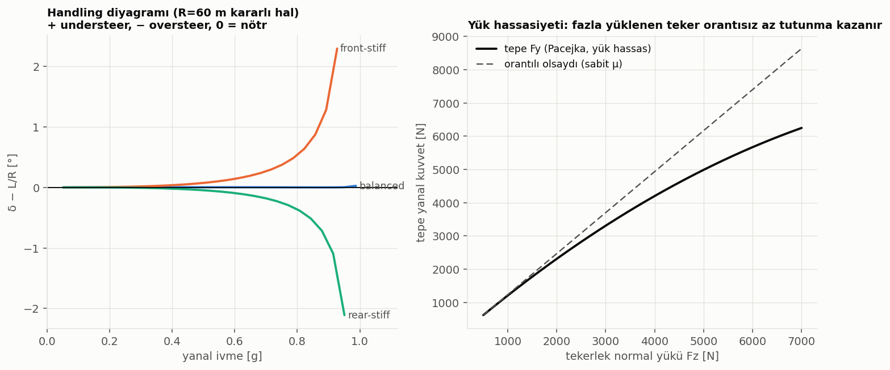
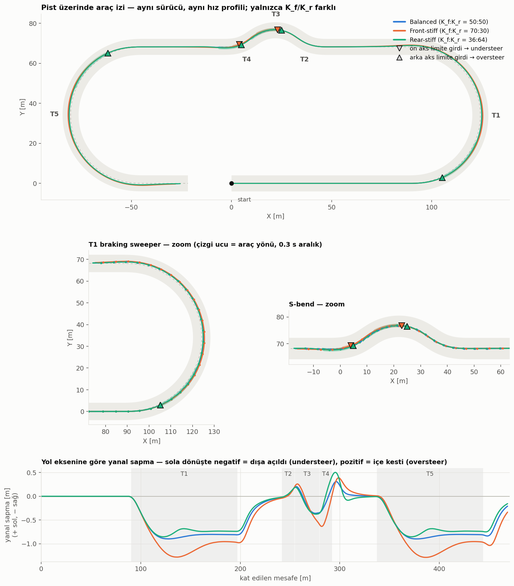
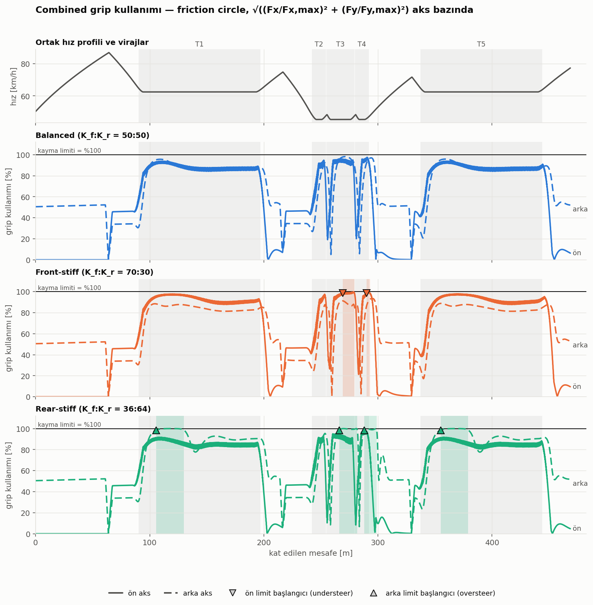
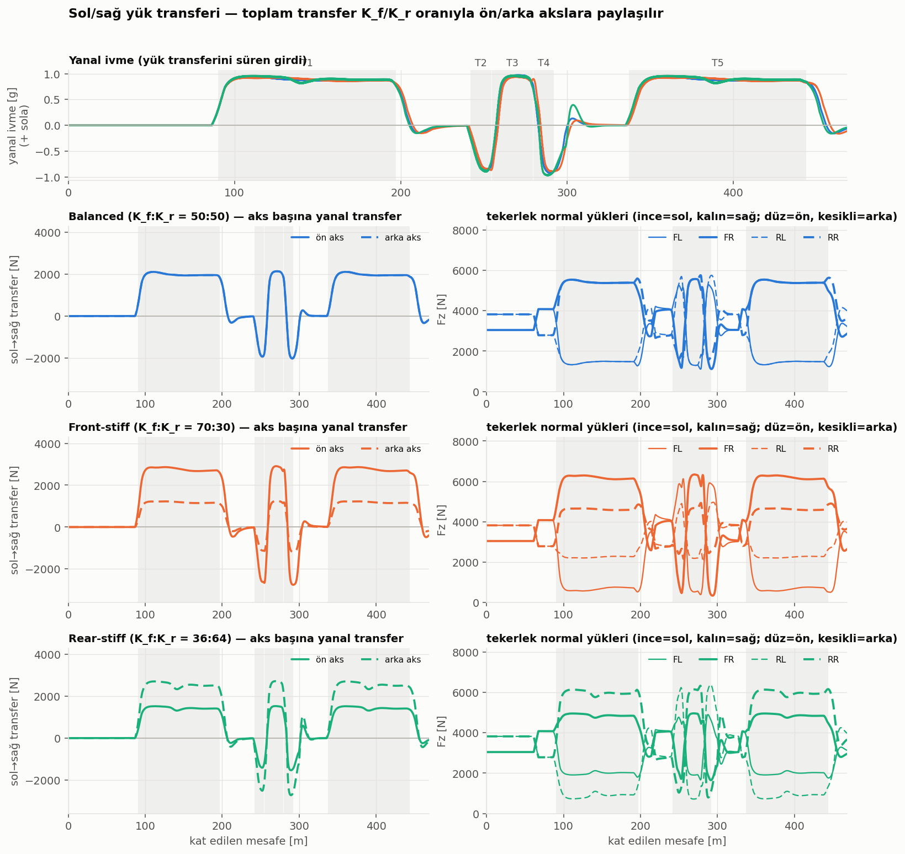
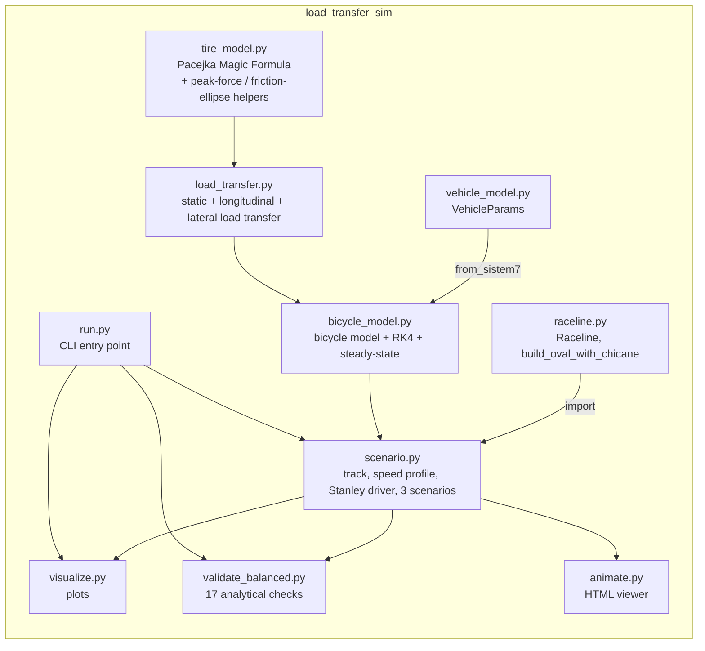

# load_transfer_sim — Understeer vs. Oversteer: Load Transfer Simulation

> Same car, same tires, same track, same driver, same speed profile — the only variable is the front/rear **roll stiffness** distribution (K_f / K_r). The result is an isolated, quantified comparison of understeer and oversteer behavior.


## Contents
- [Idea](#idea)
- [Visuals](#visuals)
- [Architecture](#architecture)
- [Model summary](#model-summary)
- [Code layout](#code-layout)
- [Setup and running](#setup-and-running)
- [Validation](#validation)
- [Findings](#findings)
- [References](#references)
- [Attribution](#attribution)
- [License](#license)

## Idea

Whether a car understeers or oversteers is largely driven by the **roll stiffness split** between the front and rear axles. This project isolates that single variable:

- Mass, inertia, wheelbase, track width, tires, brake bias, drag: **all identical** (`VehicleParams` in `vehicle_model.py`).
- Track, speed profile (g-g/friction-circle limited), and driver (Stanley controller): **all identical**.
- **Only variable:** the front roll-stiffness share K_f/(K_f+K_r) — three scenarios:

| Scenario | K_f : K_r | Expected behavior |
|---|---|---|
| `balanced` | 50 : 50 | Neutral (baseline) |
| `front_stiff` | 70 : 30 | Understeer |
| `rear_stiff` | 36 : 64 | Oversteer |

## Visuals

**Validation — is the balanced scenario really neutral?**


**Vehicle trace on track — all three scenarios overlaid**


**Friction-circle (combined grip) usage**


**Left/right and front/rear load transfer**


An interactive HTML viewer can also be generated: `python -m load_transfer_sim.animate` → `output/simulasyon.html` (no server needed, opens directly in a browser).

## Architecture



## Model summary

**Bicycle model** (`bicycle_model.py`): state vector `[X, Y, psi, vy, r, ay_f]`. Longitudinal speed `vx(t)` is prescribed by a precomputed speed profile; the required longitudinal force is split across axles by brake bias / RWD and reduces lateral force via a **friction ellipse** (combined grip). `ay_f` is a first-order lag of lateral acceleration (0.06 s) — it models roll transient behavior and breaks the algebraic `ay → Fz → Fy → ay` loop. Integration is RK4.

**Load transfer** (`load_transfer.py`): static distribution (a/b ratio) + longitudinal transfer (braking/acceleration, pitch) + lateral transfer (roll). The lateral overturning moment `M = m·ay·h_cg` is split between axles by the roll-stiffness ratio `phi_f = K_f/(K_f+K_r)` — the **single free variable** in this study.

**Tire model** (`tire_model.py`): Pacejka Magic Formula with load sensitivity (concave `mu(Fz)`) — an overloaded tire gains grip at a diminishing rate, which is exactly why load transfer reduces an axle's total grip.

**Three scenarios:** identical track (sweeper + S-bend), identical g-g-limited speed profile, identical Stanley driver — only `K_f/K_r` differs. An axle is flagged as "at the limit" when friction-circle usage ≥ 98.5% or |slip angle| ≥ the peak slip angle for ≥0.1 s (front axle → understeer event, rear axle → oversteer event).

## Code layout

| File | Role |
|---|---|
| `vehicle_model.py` | Vehicle parameters (`VehicleParams`): mass, inertia, geometry, tires |
| `raceline.py` | Fixed raceline: `Raceline`, `build_oval_with_chicane` |
| `tire_model.py` | Pacejka Magic Formula; peak-force/α-peak/friction-ellipse helpers |
| `load_transfer.py` | Static + longitudinal + lateral load transfer; `RollStiffness` dataclass |
| `bicycle_model.py` | State dynamics, RK4 integration, `steady_state` solver, `find_ay_limit` |
| `scenario.py` | Track construction, speed profile, `StanleyDriver`, 3-scenario definitions, limit-event detection |
| `validate_balanced.py` | 17 analytical validation checks for the balanced scenario + summary figure |
| `visualize.py` | Vehicle trace / grip usage / load transfer plots (matplotlib) |
| `animate.py` | Generates a 30 Hz sampled, self-contained interactive HTML viewer |
| `run.py` | CLI entry point (`balanced` / `all` stages) |
| `viewer_template.html` | HTML template `animate.py` embeds data into |

The project is self-contained: every module lives inside the `load_transfer_sim` package, with no dependency on any other project.

## Setup and running

```bash
# From the SomeSortOfSimulations/ parent folder:
pip install -r load_transfer_sim/requirements.txt

python -m load_transfer_sim.run balanced   # stage 1: balanced scenario + validation only
python -m load_transfer_sim.run all        # stage 2: all three scenarios + plots
python -m load_transfer_sim.animate        # interactive HTML viewer → output/simulasyon.html
```

Outputs are written to `load_transfer_sim/output/` (PNG plots, CSV time series, HTML viewer).

## Validation

`validate_balanced.py` verifies with **17 analytical checks** that the `balanced` (50:50) scenario is indeed neutral — e.g. `Fy(α=0)=0`, `ΣFz = m·g`, the transfer moment equaling `m·ay·h`, equal front/rear transfer in the balanced case, the front_stiff scenario correctly computing a 70% front share, the balanced car being neutral (`|δ_ss − L/R| < 0.05°`), front-stiff/rear-stiff diverging toward understeer/oversteer respectively, and the car tracking the road during the dynamic run. All checks print `[PASS]/[FAIL]` to the console when running `python -m load_transfer_sim.run balanced`.

## Findings

- **front-stiff (70:30) → understeer:** at high lateral acceleration the front axle reaches its limit before the rear; the car runs wide of the corner (turns less than the steering input implies).
- **rear-stiff (36:64) → oversteer:** the rear axle reaches its limit first; the car cuts the corner tighter and shows a tendency to rotate/slide at higher speed.
- **balanced (50:50) has the highest lateral-acceleration limit:** because front/rear grip usage is balanced, the tires' combined potential is used most efficiently — either asymmetric split exhausts its grip at a lower `ay` limit.

## References

| Topic | Source |
|---|---|
| Bicycle model, load transfer, Pacejka Magic Formula | Pacejka, H. B. — *Tire and Vehicle Dynamics* |
| Stanley controller | Hoffmann, G. M. et al. — *Autonomous Automobile Trajectory Tracking for Off-Road Driving* (DARPA Urban Challenge / Stanford Racing Team) |
| Friction circle / combined slip | Milliken & Milliken — *Race Car Vehicle Dynamics* |
| Tire and vehicle parameters | This project's own `tire_model.py` / `vehicle_model.py` |

## Attribution

The topic of this project (understeer vs. oversteer comparison) was inspired by an "Understeer vs Oversteer" post shared on Instagram by [@veer.alak.sim](https://www.instagram.com/veer.alak.sim/). All code, models, and the simulation itself were written from scratch for this project.

## License

MIT — see [LICENSE](LICENSE).
