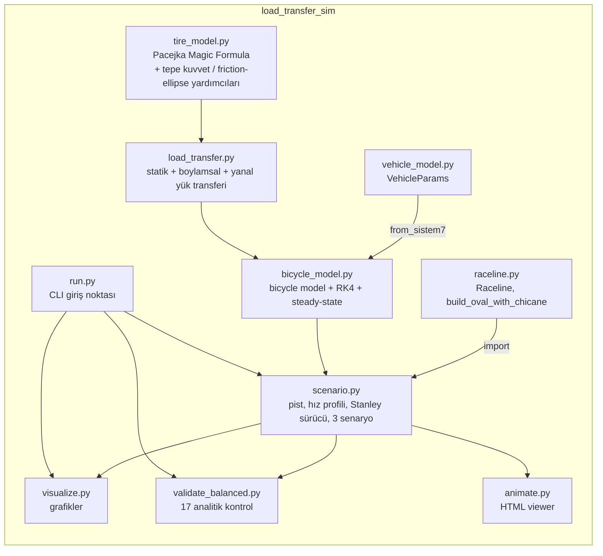

# load_transfer_sim — Understeer vs. Oversteer: Yük Transferi Simülasyonu

> Aynı araç, aynı lastik, aynı pist, aynı sürücü, aynı hız profili — tek değişken ön/arka **roll stiffness** dağılımı (K_f / K_r). Sonuç: understeer (anlaşma) ve oversteer (savrulma) davranışı sayılarla ve grafiklerle karşılaştırılıyor.


## İçindekiler
- [Fikir](#fikir)
- [Görseller](#görseller)
- [Mimari](#mimari)
- [Model özeti](#model-özeti)
- [Kod yapısı](#kod-yapısı)
- [Kurulum ve çalıştırma](#kurulum-ve-çalıştırma)
- [Doğrulama](#doğrulama)
- [Bulgular](#bulgular)
- [Kaynakça](#kaynakça--references)
- [Attribution](#attribution)
- [Lisans](#lisans)

## Fikir

Bir aracın understeer mi yoksa oversteer mi davranacağı büyük ölçüde ön ve arka akslar arasındaki **roll stiffness (burulma sertliği) dağılımına** bağlıdır. Bu proje bunu izole bir deney olarak gösteriyor:

- Kütle, ataletler, dingil mesafesi, iz genişliği, lastikler, fren dengesi, sürükleme katsayısı: **hepsi aynı** (`vehicle_model.py`'deki `VehicleParams`).
- Pist, hız profili (g-g/friction-circle sınırlı) ve sürücü (Stanley kontrolcü) **hepsi aynı**.
- **Tek değişken:** K_f/(K_f+K_r) oranı — üç senaryo:

| Senaryo | K_f : K_r | Beklenen davranış |
|---|---|---|
| `balanced` | 50 : 50 | Nötr (referans) |
| `front_stiff` | 70 : 30 | Understeer |
| `rear_stiff` | 36 : 64 | Oversteer |

## Görseller

**Doğrulama — balanced senaryosu nötr mü?**


**Pist üzerinde araç izi — üç senaryo üst üste**


**Friction-circle (combined grip) kullanımı**


**Sol/sağ ve ön/arka yük transferi**


İnteraktif bir HTML görünümü de üretilebilir: `python -m load_transfer_sim.animate` → `output/simulasyon.html` (sunucu gerekmez, tarayıcıda açılır).

## Mimari



## Model özeti

**Bicycle model** (`bicycle_model.py`): durum vektörü `[X, Y, psi, vy, r, ay_f]`. Boylamsal hız `vx(t)` önceden verilen bir hız profilinden gelir; gereken boylamsal kuvvet fren dengesi/RWD ile akslara dağıtılır ve **friction-ellipse** (combined grip) yoluyla yanal kuvveti azaltır. `ay_f`, yanal ivmenin 0.06 s birinci derece gecikmeli hâli — hem roll geçişini modelliyor hem de `ay → Fz → Fy → ay` cebirsel döngüsünü kırıyor. Entegrasyon RK4 ile yapılıyor.

**Yük transferi** (`load_transfer.py`): statik dağılım (a/b oranı) + boylamsal transfer (frenleme/ivmelenme, pitch) + yanal transfer (roll). Yanal devirme momenti `M = m·ay·h_cg`, roll stiffness oranına göre `phi_f = K_f/(K_f+K_r)` ile akslara paylaşılır — bu, projedeki **tek serbest değişken**.

**Lastik modeli** (`tire_model.py`): Pacejka Magic Formula, yük hassasiyetli (`mu(Fz)` içbükey) — fazla yüklenen teker orantısız az tutunma kazanır; yük transferinin toplam aks tutunmasını neden azalttığının sebebi budur.

**Üç senaryo:** aynı pist (sweeper + S-bend), aynı g-g sınırlı hız profili, aynı Stanley sürücü — yalnızca `K_f/K_r` farklı. Limit tespiti: bir aks, friction-circle kullanımı ≥ %98.5 veya |kayma açısı| ≥ tepe kayma açısına ≥0.1 s süreyle ulaşırsa "limitte" sayılır (ön aks → understeer olayı, arka aks → oversteer olayı).

## Kod yapısı

| Dosya | Görev |
|---|---|
| `vehicle_model.py` | Araç parametreleri (`VehicleParams`): kütle, atalet, geometri, lastikler |
| `raceline.py` | Sabit raceline: `Raceline`, `build_oval_with_chicane` |
| `tire_model.py` | Pacejka Magic Formula; tepe kuvvet/α_pik/friction-ellipse yardımcıları |
| `load_transfer.py` | Statik + boylamsal + yanal yük transferi; `RollStiffness` dataclass |
| `bicycle_model.py` | Durum dinamiği, RK4 entegrasyon, `steady_state` çözücü, `find_ay_limit` |
| `scenario.py` | Pist inşası, hız profili, `StanleyDriver`, 3 senaryo tanımı, limit olayı tespiti |
| `validate_balanced.py` | Balanced senaryosu için 17 analitik doğrulama kontrolü + özet şekil |
| `visualize.py` | Araç izi / grip kullanımı / yük transferi grafikleri (matplotlib) |
| `animate.py` | 30 Hz örneklenmiş, tek-dosyalık interaktif HTML viewer üretir |
| `run.py` | CLI giriş noktası (`balanced` / `all` aşamaları) |
| `viewer_template.html` | `animate.py`'nin veri gömdüğü HTML şablonu |

Proje bağımsızdır: tüm modüller `load_transfer_sim` paketi içindedir, başka bir projeye bağımlılığı yoktur.

## Kurulum ve çalıştırma

```bash
# SomeSortOfSimulations/ üst klasöründe:
pip install -r load_transfer_sim/requirements.txt

python -m load_transfer_sim.run balanced   # 1. aşama: yalnızca balanced + doğrulama
python -m load_transfer_sim.run all        # 2. aşama: üç senaryo + grafikler
python -m load_transfer_sim.animate        # interaktif HTML viewer → output/simulasyon.html
```

Çıktılar `load_transfer_sim/output/` altına yazılır (PNG grafikler, CSV zaman serileri, HTML viewer).

## Doğrulama

`validate_balanced.py`, `balanced` (50:50) senaryosunun gerçekten nötr olduğunu **17 analitik kontrolle** doğrular — örn. `Fy(α=0)=0`, `ΣFz = m·g`, transfer momentinin `m·ay·h` olması, balanced'da ön/arka transferin eşitliği, front-stiff senaryosunda ön pay %70'in doğru hesaplanması, balanced'ın nötr olması (`|δ_ss − L/R| < 0.05°`), front-stiff'in understeer / rear-stiff'in oversteer yönünde ayrışması, ve dinamik koşuda aracın pisti takip etmesi. Tüm kontroller `python -m load_transfer_sim.run balanced` çalıştırıldığında konsola `[PASS]/[FAIL]` olarak yazdırılır.

## Bulgular

- **front-stiff (70:30) → understeer:** Yüksek yanal ivmede ön aks arka akstan önce limite giriyor; araç virajın dışına açılıyor (direksiyon girdisine rağmen daha az dönüyor).
- **rear-stiff (36:64) → oversteer:** Arka aks önce limite giriyor; araç virajı daha dar kesiyor, yüksek hızda savrulma eğilimi gösteriyor.
- **balanced (50:50) en yüksek yanal ivme limitine sahip:** Ön/arka grip kullanımı dengeli olduğundan, lastiklerin toplam potansiyeli en verimli şekilde kullanılıyor — asimetrik dağılımların ikisi de daha düşük bir `ay` limitinde tükeniyor.

## Kaynakça / References

| Konu | Kaynak |
|---|---|
| Bicycle model, yük transferi, Pacejka Magic Formula | Pacejka, H. B. — *Tire and Vehicle Dynamics* |
| Stanley kontrolcü | Hoffmann, G. M. et al. — *Autonomous Automobile Trajectory Tracking for Off-Road Driving* (DARPA Urban Challenge / Stanford Racing Team) |
| Friction-circle / combined slip | Milliken & Milliken — *Race Car Vehicle Dynamics* |
| Lastik ve araç parametreleri | Bu projenin kendi `tire_model.py` / `vehicle_model.py` dosyaları |

## Attribution

Bu projenin konusu (understeer vs. oversteer karşılaştırması), Instagram'da [@veer.alak.sim](https://www.instagram.com/veer.alak.sim/) hesabının paylaştığı bir "Understeer vs Oversteer" içeriğinden esinlenilmiştir. Kod, modeller ve simülasyon tamamen bu proje için sıfırdan yazılmıştır.

## Lisans

MIT — bkz. [LICENSE](LICENSE).
